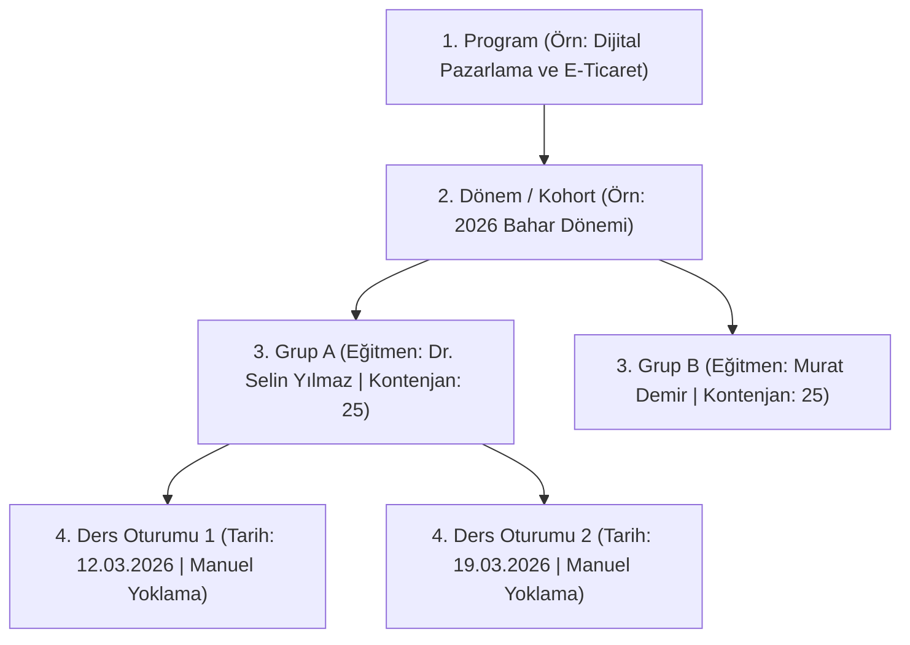

# İslahiye Ticaret Odası Eğitim Portalı — Akademi ve Kursiyer Yönetim Sistemi

İslahiye Ticaret Odası bünyesinde yürütülen mesleki gelişim, dijital dönüşüm ve girişimcilik eğitimlerini uçtan uca planlamak, yürütmek, denetlemek ve resmi başarı belgeleriyle kayıt altına almak üzere geliştirilmiş bağımsız bir akademi yönetim platformudur.

---

## 1. Ürünün Amacı ve Hedef Kitlesi

### Temel Amaç
- **Nitelikli İş Gücü ve Kapasite Geliştirme:** İslahiye ve çevresindeki gençlerin, kadın girişimcilerin ve üreticilerin dijital beceriler, dış ticaret, tarımsal e-ticaret ve işletme yönetimi alanlarında kurumsal standartlarda eğitilmesini sağlamak.
- **Uçtan Uca Operasyon Yönetimi:** Aday başvurusundan dinamik kriter puanlamasına, kesin kayıttan şubeleşmeye, manuel oturum yoklamasından ödev revizyonlarına ve nihai başarı onayına kadar tüm eğitim adımlarını tek elden yürütmek.
- **Güvenilir ve Doğrulanabilir Sertifikasyon:** Mezun kursiyerlerin başarı belgelerini tekil karekod ve doğrulama kodlarıyla halka açık doğrulama kütüğüne bağlamak.
- **Şeffaf ve Açıklanabilir Süreçler:** Başvuru puanlaması ve başarı değerlendirmelerinde keyfiyeti önleyen sürümlü kural motorları ve denetim izleri sunmak.

### Hedef Kitle ve Kullanıcı Rolleri
1. **Ziyaretçiler & Genel Kamuoyu:** Açılan eğitimleri inceleyen, 2026 akademik takvimini takip eden ve karekodlu mezuniyet belgelerini sorgulayan işverenler ve vatandaşlar.
2. **Aday Kursiyerler (`applicant`):** Açık programlara başvuran, kriter formlarını dolduran ve başvuru değerlendirme sürecini canlı takip eden bireyler.
3. **Kursiyerler (`trainee`):** Kesin kaydı tamamlanmış, ders programını takip eden, ödev teslim eden, revizyonları tamamlayan, eğitmeniyle mesajlaşan ve belgelerini indiren öğrenciler.
4. **Eğitmenler (`instructor`):** Kendisine atanan gruplarda ders oturumlarını yürüten, manuel yoklama alan, ödev konularını açan, teslimleri puanlayan ve öğrencilere geri bildirim veren uzmanlar.
5. **Eğitim Yöneticileri (`admin`):** Başvuru ön elemesini yapan, kesin kayıt ve grup kontenjanlarını belirleyen, oturum takvimini yöneten, devamsızlık ve ödev denetimlerini inceleyen, nihai başarı kararını veren ve belgeleri düzenleyen oda sorumluları.
6. **Süper Yöneticiler (`superadmin`):** 24 anahtarlı granüler yetki matrisini yöneten, kullanıcı hesaplarını açıp kapatan, sürümlü sistem politikalarını (devamsızlık/geçme eşikleri) belirleyen ve maskelenmiş denetim günlüklerini izleyen sistem amirleri.

---

## 2. Akademik ve Operasyonel Hiyerarşi

Platform, eşzamanlı çoklu grup ve eğitmen yönetimini güvenceye alan 4 katmanlı katı bir veri hiyerarşisi üzerine kuruludur:



1. **Program (`Program`):** Eğitimin genel çerçevesi, müfredat modülleri, hedefleri ve kazanımları.
2. **Dönem (`Term / Cohort`):** Eğitimin belirli bir zaman diliminde açılan akademik takvim sürümü.
3. **Grup / Şube (`Group`):** Belirli bir eğitmene ve kontenjana bağlı, aynı anda paralel ilerleyen kursiyer kümesi.
4. **Ders Oturumu (`Session`):** Belirli tarih, saat ve derslikte gerçekleşen, eğitmenin manuel yoklama aldığı birincil operasyonel birim.

---

## 3. Halka Açık Ziyaretçi Modülleri

Kullanıcı girişi gerektirmeyen, şeffaf ve kurumsal kamu bilgilendirme sayfaları:

- **Halka Açık Ana Sayfa (`/`):** İslahiye Ticaret Odası Eğitim Portalı'nın vizyonu, öne çıkan programlar, istatistiki göstergeler ve hızlı başvuru bağlantıları.
- **Eğitim Kataloğu (`/egitimler`):** Kategori bazlı (Tarım & E-Ticaret, Dış Ticaret, Dijital Beceriler, Girişimcilik), seviye ve eğitim türüne göre filtrelenebilir program listesi.
- **Program Detay & Müfredat (`/egitimler/:id`):** Haftalık ders planı, eğitmen kadrosu, kazanımlar, kontenjan doluluk durumu ve ön başvuru butonu.
- **Başvuru Rehberi (`/basvuru-rehberi`):** Adayların başvuru, ön eleme kriterleri, kesin kayıt ve sertifikasyon aşamalarını adım adım anlatan rehber.
- **2026 Eğitim Takvimi (`/egitim-takvimi`):** Yıl boyunca planlanan dönemlerin başlangıç, başvuru ve bitiş tarihlerini gösteren interaktif takvim.
- **Karekodlu Belge Doğrulama (`/belge-dogrula`, `/belge-dogrula/:verificationCode`):** Kurum tarafından verilen başarı ve katılım belgelerinin doğruluğunu anlık sorgulayan doğrulama motoru.
- **Kullanıcı Girişi (`/giris`):** Tüm roller için tek ekrandan e-posta/şifre girişi ve hızlı demo rol geçiş butonları.
- **Yeni Aday Kaydı (`/hesap-olustur`):** Adayların sisteme ön kayıt oluşturmasını sağlayan doğrulama kontrollü kayıt formu.

---

## 4. Rol Bazlı Kullanıcı Deneyimleri

### 4.1. Aday Paneli (`/aday`)
- **Dinamik Başvuru Formu (`/aday/basvuru/:programId`):** Seçilen programa ait çok adımlı başvuru formu; kişisel bilgiler, ikamet durumu, eğitim geçmişi ve programa özel dinamik kriter soruları.
- **Başvuru Süreç Takibi:** Gönderilen başvurunun güncel aşaması (Taslak, İnceleniyor, Kabul Edildi, Yedek, Reddedildi).
- **Şeffaf Geri Bildirim:** Yönetici kararı sonrası adaya iletilen açıklama metni ve kesin kayıt yönlendirmesi.

### 4.2. Kursiyer Paneli (`/kursiyer`)
- **Akademik Gösterge Paneli:** Toplam ders saati, devam oranı (% olarak), ödev not ortalaması (100 üzerinden) ve belge hak ediş durumu.
- **Haftalık Ders Takvimi:** Yaklaşan oturumlar, derslik bilgisi ve oturum durumu.
- **Ödev Teslim Masası:** Zorunlu ve seçmeli ödevlerin listesi, dosya/bağlantı/metin teslimi, geçmiş revizyon kayıtları ve eğitmen notları.
- **Belgelerim Alanı:** Hak kazanılan resmi başarı belgelerinin görüntülenmesi, PDF formatında indirilmesi ve doğrulama kodunun paylaşılması.
- **Kursiyer İletişim Kanalları:**
  - **Eğitmen Özel Mesajları (`/kursiyer/mesajlar`):** Yalnızca kayıtlı olduğu grubun eğitmeniyle bire bir mesajlaşma.
  - **Grup Sınıf Kanalı (`/kursiyer/kanallar`):** Yalnızca kendi sınıf arkadaşları ve eğitmeninin bulunduğu kapalı duyuru/tartışma kanalı.

### 4.3. Eğitmen Paneli (`/egitmen`)
- **Oturum Yönetimi & Manuel Yoklama:**
  - Tarihi gelen oturumu başlatma ve yoklama listesini açma.
  - Her kursiyer için **Katıldı**, **Katılmadı** veya **Mazeretli** durumunu manuel işaretleme.
  - Asla QR yoklama veya "Geç Kaldı" durumu bulunmaz; yoklama eğitmenin resmi beyanıdır.
  - Gerekçeli yoklama düzeltme geçmişi.
- **Ödev & Proje Değerlendirme:**
  - Kursiyer teslimlerini inceleme, 0-100 arasında puan verme.
  - Yetersiz görülen çalışmalarda gerekçe belirterek revizyon isteme.
  - Eski revizyon geçmişini ve önceki puanları koruyarak yeni teslimi değerlendirme.
- **Eğitmen İletişim Masası:**
  - **Kursiyer Mesajları (`/egitmen/mesajlar`):** Kendi grubundaki kursiyerlerden gelen soruları yanıtlama.
  - **Sınıf Kanalları (`/egitmen/kanallar`):** Sınıfa toplu duyuru ve ders materyali paylaşma.

### 4.4. Yönetici Masaları (`/yonetim`)
- **Genel Bakış Dashboardu (`/yonetim`):** Aktif programlar, toplam kursiyer sayısı, devam riski taşıyanlar, onay bekleyen başarı kararları ve operasyon grafikleri.
- **Başvuru Karar Masası (`/yonetim/basvurular`):** Gelen başvuruların listelenmesi, kriter puanına göre sıralanması, yönetici tarafından kabul/yedek/ret kararlarının verilmesi.
- **Kriter & Puanlama Masası (`/yonetim/kriterler`):** Başvuru ön elemesinde kullanılan ağırlıklı kriterlerin (İkamet, Mezuniyet, Üretim Deneyimi vb.) tanımlanması, katsayılarının ve puan baremlerinin sürümlenmesi.
- **Kesin Kayıt Masası (`/yonetim/kesin-kayit`):** Kabul edilen adayların kesin kayıt işlemlerinin onaylanması.
- **Grup & Kontenjan Masası (`/yonetim/gruplar`):** Programlara bağlı şubelerin açılması, eğitmen atanması, kontenjan takibi ve gruplar arası kursiyer transferi.
- **Oturum & Takvim Planlama (`/yonetim/oturumlar`):** Ders oturumlarının tarihlerinin planlanması, derslik tahsisi ve oturum iptali (iptal edilen oturum devam paydasından otomatik düşülür).
- **Yoklama Denetim Masası (`/yonetim/yoklama-denetim`):** Tüm sınıfların devam oranlarının merkezi denetimi, devamsızlık sınırını aşma riski taşıyan kursiyerlerin tespiti.
- **Ödev & Değerlendirme Denetimi (`/yonetim/odevler`):** Eğitmenlerin verdiği ödevler, teslim oranları, ortalama notlar ve geciken değerlendirmelerin izlenmesi.
- **Nihai Başarı Onayı & Dönem Kütüğü (`/yonetim/basari-onay`):** Dönem sonunda tüm akademik koşulları sağlayan kursiyerlerin listelenmesi ve yetkili yöneticinin resmi başarı onayı vermesi.
- **Belge Kütüğü & PDF/QR Masası (`/yonetim/belgeler`):** Onaylanan kursiyerlere tekil numaralı (`İE-2026-BB-001`) belgelerin basılması, karekod üretimi, belge iptali ve yeniden basım süreçleri.
- **Grup Kanalları Yönetimi (`/yonetim/kanallar`):** Tüm sınıf kanallarını izleme, arşivleme ve moderasyon.
- **Kurumsal Duyuru Masası (`/yonetim/duyurular`):** Portal geneline veya belirli programlara yönelik kurumsal bildirim yayınlama.
- **Toplu E-Posta Simülasyon Masası (`/yonetim/toplu-eposta`):** Başvuru sonuçları, yoklama uyarıları ve sertifika bildirimleri için şablonlu toplu e-posta kuyruğu simülasyonu.

### 4.5. Süper Yönetici Konsolu (`/yonetim/super-admin`)
- **Granüler Yetki Matrisi (`/yonetim/roller`):** 24 farklı yetki anahtarının 4 kapsam düzeyinde (`global`, `program`, `group`, `self`) rollere göre dinamik yönetimi.
- **Kullanıcı ve Rol Yönetimi (`/yonetim/kullanicilar`):** Sistemdeki tüm kullanıcıların hesap durumları, rol atamaları ve işlem yetkileri.
- **Sistem ve Politika Ayarları (`/yonetim/ayarlar`):** Sürümlü olarak yönetilen devamsızlık sınırı (%80), başarı notu barajı (70/100) ve kural revizyonları.
- **Merkezi Denetim Kayıtları (`/yonetim/denetim`):** Sistemde gerçekleşen tüm kritik işlemlerin (not değişikliği, yoklama düzeltme, yetki atama, belge iptali) maskelenmiş denetim izleri.
- **Operasyonel Raporlama (`/yonetim/raporlar`):** Dönemsel başarı oranları, başvuru istatistikleri ve kurumsal performans grafikleri.
- **Özel Ayrılmış Demo Masası (`/demo`):** Test ve tanıtım süreçlerinde tüm rolleri tek tıkla simüle eden ve veri tabanını fabrika ayarlarına sıfırlayan demo merkezi.

---

## 5. Kesin İş Kuralları ve Mantıksal Motorlar

Platformda tüm süreçler, `AGENTS.md` ve proje şartnamesinde belirlenen kesin kurallara göre işletilir:

### 5.1. Manuel Yoklama Kuralı
- Yoklama **yalnızca yetkili eğitmen tarafından elle (manuel)** alınır.
- Karekod (QR) ile yoklama alma özelliği **kesinlikle yoktur**.
- Yoklama durumları yalnızca 3 tiptir:
  1. **Katıldı (`attended`)**
  2. **Katılmadı (`absent`)**
  3. **Mazeretli (`excused`)**
- "Geç kaldı" statüsü **yoktur**.
- İptal edilen ders oturumları, devam yüzdesi hesaplanırken **paydadan düşülür** ve kursiyer aleyhine devamsızlık sayılmaz.

### 5.2. Başarı ve Belge Hak Ediş Formülü
Bir kursiyerin başarı belgesi almaya hak kazanabilmesi için aşağıdaki 4 şartın **aynı anda** sağlanması zorunludur:
1. **Devam Oranı:** En az **%80** devam sağlamış olmak (Mazeretli izinler kurum politikasına göre değerlendirilir).
2. **Ödev Not Ortalaması:** Değerlendirilen ödevlerden en az **70 / 100** genel ortalama tutturmak.
3. **Zorunlu Ödevler:** Müfredatta "Zorunlu" olarak işaretlenmiş tüm ödevlerin eğitmen tarafından onaylanmış olması.
4. **Nihai Yönetici Onayı:** Akademik şartlar sağlansa dahi, yetkili oda yöneticisi (`admin`) tarafından "Nihai Başarı Onayı" verilmeden belge düzenlenemez. Sistem otomatik belge üretmez.

### 5.3. Belge Doğrulama ve Karekod Mimarisi
- **Karekodun Tek Amacı:** Sistemdeki QR kodlar **yalnızca ve kesinlikle belge doğrulama** için kullanılır; yoklama için kullanılamaz.
- **Doğrulama Kodu Formatı:** Her belgeye özel kriptografik simülasyonlu tekil kod atanır (Örn: `IE-VER-89104`).
- **Belge Seri Numarası Formatı:** `İE-2026-BB-001` (İE: İslahiye Eğitim, Yıl, Belge Tipi, Sıra No).
- **Vektörel & PNG Üretimi:** Karekodlar istemci tarafında `qrcode` ve `pngjs` kütüphaneleriyle dinamik üretilir ve kamuya açık doğrulama bağlantısına yönlendirir (`/belge-dogrula/:verificationCode`).

### 5.4. Dinamik Başvuru Puanlama Motoru
- Başvurularda komisyon paneli yoktur; yetkili yöneticinin belirlediği nesnel kriterler kullanılır.
- Kriterler ağırlıklı puanlara sahiptir (Örn: İslahiye'de ikamet: +30 puan, İlgili ön lisans/lisans mezuniyeti: +25 puan, Aktif çiftçi/üretici belgesi: +20 puan).
- Sistem, aday formuna göre bir ön eleme puanı hesaplar ve adayları sıralar; ancak nihai kabul/yedek kararını yetkili yönetici verir.

---

## 6. Granüler Yetki Matrisi (24 Anahtar & 4 Kapsam)

Süper Yönetici Konsolu (`/yonetim/roller`) üzerinden yönetilen izin matrisi:

| Yetki Kategorisi | İzin Anahtarı (`PermissionKey`) | Açıklama | Desteklenen Kapsamlar (`Scopes`) |
|---|---|---|---|
| **Başvuru Yönetimi** | `applications.view` | Başvuruları ve aday formlarını görüntüleme | `global`, `program`, `self` |
| | `applications.submit` | Yeni eğitim başvurusu gönderme | `self` |
| | `applications.evaluate` | Başvuru kriter puanlarını hesaplama ve inceleme | `global`, `program` |
| | `applications.decide` | Başvurulara nihai kabul/yedek/ret kararı verme | `global`, `program` |
| | `criteria.manage` | Puanlama kriterlerini ve katsayıları düzenleme | `global` |
| **Eğitim Operasyonu** | `programs.manage` | Eğitim programlarını açma, düzenleme ve kapatma | `global` |
| | `terms.manage` | Dönem ve kohort takvimlerini yönetme | `global`, `program` |
| | `groups.manage` | Şube açma, eğitmen atama ve kontenjan belirleme | `global`, `program` |
| | `enrollments.confirm` | Kabul edilen adayların kesin kaydını tamamlama | `global`, `program` |
| | `sessions.manage` | Ders oturumlarını planlama, iptal etme veya taşıma | `global`, `program`, `group` |
| | `attendance.mark` | Oturumda manuel yoklama alma | `group` (eğitmen) |
| | `attendance.correct` | Geçmiş yoklama kaydını gerekçeli düzeltme | `global`, `group` |
| **Ödev ve Başarı** | `assignments.create` | Yeni ödev veya proje konusu tanımlama | `group` (eğitmen) |
| | `assignments.evaluate` | Teslim edilen ödevlere not verme ve revizyon isteme | `group` (eğitmen) |
| | `success.review` | Dönem sonu başarı ve devam tablosunu inceleme | `global`, `program`, `group` |
| | `success.approve` | Resmi nihai başarı onayını verme | `global`, `program` |
| **Belge & Sertifika** | `certificates.issue` | Başarı ve katılım belgesi düzenleme | `global`, `program` |
| | `certificates.cancel` | Düzenlenmiş bir belgeyi gerekçeli iptal etme | `global` |
| | `certificates.verify` | Karekodlu belge doğrulama sorgusu yapma | `global` (halka açık) |
| **İletişim & Duyuru** | `channels.manage` | Sınıf kanallarını açma ve moderasyon yapma | `global`, `group` |
| | `announcements.publish` | Kurumsal duyuru yayınlama | `global`, `program` |
| | `massEmail.queueDemo` | Toplu e-posta gönderim kuyruğunu tetikleme | `global` |
| **Yönetişim & Sistem** | `users.view` / `roles.manage` | Kullanıcı hesaplarını ve rollerini yönetme | `global` |
| | `permissions.manage` | Granüler yetki matrisini güncelleme | `global` |
| | `settings.manage` | Sistem politikalarını ve eşik değerlerini belirleme | `global` |
| | `audit.view` | Maskelenmiş merkezi denetim kayıtlarını inceleme | `global` |
| | `reports.view` | Kurumsal operasyonel raporları görüntüleme | `global`, `program` |

---

## 7. Kurumsal Tasarım Sistemi: Derin Çivit & Arduvaz

Eğitim platformu, veri yoğun paneller, okunaklı tablolar ve resmi kurum kimliğine uygun **"Derin Çivit & Arduvaz Kurumsal"** paletini kullanır:

- **Derin Arduvaz / Navy 900 (`#0F172A`):** Koyu başlıklar, sidebar arka planı ve birincil kurumsal metinler.
- **Kurumsal Mavi / Blue 900 (`#1E3A8A`):** Kart vurguları, aktif menü göstergeleri ve üst bant.
- **Canlı Vurgu Mavisi / Blue 600 (`#2563EB`):** Birincil butonlar, durum rozetleri ve interaktif bağlantılar.
- **Açık Zemin Grisi / Slate 50 (`#F8FAFC`):** Gözü yormayan nötr sayfa ve panel arka planları.
- **Tipografi:** Google Fonts `Inter` — Tablolar, formlar ve veri gridleri için yüksek okunurluk.
- **Erişilebilirlik:** WCAG 2.1 AA kontrast standartları, form elemanlarında açık hata durumları ve ekran okuyucu etiketleri.

---

## 8. Klasör Yapısı (`apps/egitim/src`)

```
apps/egitim/src/
├── assets/                 # Kurumsal logolar, ikonlar ve görsel varlıklar
├── components/
│   ├── common/             # Butonlar, modallar, kartlar, rozetler ve tablolar
│   ├── layout/             # EducationLayout (Sidebar, Topbar) ve DemoRoleContext
│   ├── public/             # PublicEducationLayout (Halka açık navbar ve footer)
│   ├── candidate/          # Aday başvuru ve aşama bileşenleri
│   ├── trainee/            # Kursiyer ödev, devam ve takvim bileşenleri
│   ├── instructor/         # Eğitmen yoklama masası ve ödev değerlendirme arayüzleri
│   ├── admin/              # Başvuru karar, kriter, oturum ve kütük bileşenleri
│   ├── superadmin/         # Yetki matrisi, kullanıcı düzenleme ve denetim panelleri
│   └── certificate/        # Dinamik PDF ve karekodlu belge şablonları
├── data/
│   └── educationData.ts    # İlk başlangıç mock veri seti (programlar, oturumlar, kullanıcılar)
├── pages/                  # 30+ bağımsız React sayfa bileşeni (Halka açık ve rol sayfaları)
├── services/               # 26 adet tipli iş mantığı ve localStorage depolama servisi
│   ├── applicationStorage.ts    # Başvuru verisi ve durum yönetimi
│   ├── assignmentEngine.ts      # Ödev not ortalaması ve revizyon motoru
│   ├── attendanceEngine.ts      # %80 devam hesabı ve iptal edilen ders formülü
│   ├── auditStorage.ts          # Maskelenmiş sistem işlem günlükleri
│   ├── certificateStorage.ts    # Tekil seri no ve doğrulama kütüğü
│   ├── criteriaEngine.ts        # Dinamik ağırlıklı puanlama algoritması
│   ├── permissionEngine.ts      # Granüler yetki kontrol motoru
│   ├── successEngine.ts         # 4 aşamalı nihai başarı değerlendirme motoru
│   └── ...                      # Mesajlaşma, kanal, toplu e-posta ve ayar servisleri
├── styles/
│   └── index.css           # Tailwind CSS direktifleri ve kurumsal tema tanımları
├── types/
│   ├── index.ts            # Program, oturum, yoklama, ödev ve başarı tipleri (900+ satır)
│   ├── permissionTypes.ts  # 24 yetki anahtarı, 4 kapsam ve matris tipleri
│   ├── auditTypes.ts       # Denetim kaydı ve maskeleme tipleri
│   ├── notificationTypes.ts# Bildirim, kanal ve duyuru tipleri
│   └── settingsTypes.ts    # Sürümlü sistem politikası veri modelleri
├── App.tsx                 # Tüm açık ve korumalı rotaların tanımlandığı ana yönlendirici
└── main.tsx                # React 18 bootstrap giriş noktası
```

---

## 9. Geliştirme ve Çalıştırma Komutları

Uygulama klasöründe doğrudan çalıştırılabilecek doğrulanmış npm komutları:

```bash
# apps/egitim klasörüne geçiş yapıldığında:
cd apps/egitim

# 1. Geliştirme Sunucusunu Başlat (Port 5174 üzerinde açılır)
npm run dev

# 2. TypeScript Tip Kontrolü ve Optimize Üretim Derlemesi
npm run build

# 3. Derlenmiş Üretim Paketini Yerel Olarak Önizle
npm run preview
```

> **Not:** Monorepo kök dizininden çalıştırmak için `npm run dev:egitim` komutunu kullanabilirsiniz.

---

## 10. Mevcut Geliştirme Durumu ve Üretim Ortamı Yol Haritası

### Mevcut Geliştirme Durumu (Frontend Simülasyonu)
- **Arayüz ve Deneyim:** Sistem, tüm halka açık sayfaları, aday formlarını, kursiyer/eğitmen panellerini, idari karar masalarını ve süper yönetici yetki matrisini içeren eksiksiz ve çalışan bir frontend prototipidir.
- **Veri Saklama:** Demo verileri tarayıcının `localStorage` alanında saklanır; sayfa yenilendiğinde yapılan işlemler korunur.
- **Rol Değiştirme:** Gerçek bir kimlik doğrulama sunucusu yerine, hızlı değerlendirme ve test imkânı sağlayan `DemoRoleContext` üzerinden rol geçişi simüle edilir.
- **İletişim ve E-Posta:** Mesajlaşma ve toplu e-posta gönderimleri tarayıcı içi simülasyon kuyrukları üzerinden yürütülür; harici sunucuya gerçek e-posta veya SMS atılmaz.

### Üretim Ortamı Gereksinimleri (Production Backend Roadmap)
Sistemin sahada resmî olarak devreye alınabilmesi için gelecekte geliştirilecek kurumsal altyapı adımları:
1. **Merkezi Backend API:** ASP.NET Core Web API (veya eşdeğer kurumsal REST mimarisi) ile iş kurallarının ve yetkilendirmelerin sunucu tarafında doğrulanması.
2. **İlişkisel Veritabanı:** PostgreSQL veya Microsoft SQL Server üzerinde `Program`, `Dönem`, `Grup`, `Oturum`, `Yoklama`, `Ödev`, `Kullanıcı` tabloları ve transaction güvencesi.
3. **Gerçek Kimlik Doğrulama (Auth & RBAC):** JWT / OAuth2 tabanlı oturum yönetimi, güvenli şifreleme (Argon2/bcrypt) ve frontenddeki 24 yetki anahtarının API middleware katmanında doğrulanması.
4. **Resmî e-İmza ve Karekod Entegrasyonu:** Düzenlenen başarı belgelerinin kurum yetkilileri tarafından 5070 sayılı kanuna uygun güvenli elektronik imza veya mobil imza ile imzalanması ve zaman damgası eklenmesi.
5. **Gerçek İletişim Servisleri:** İslahiye Ticaret Odası kurumsal SMTP sunucusu ve SMS başlığı üzerinden otomatik bilgilendirme gönderimi.
6. **KVKK ve Veri Güvenliği:** T.C. kimlik numaraları, iletişim bilgileri ve ikamet belgelerinin KVKK standartlarına uygun olarak veritabanında şifrelenmiş (AES-256) biçimde saklanması.
